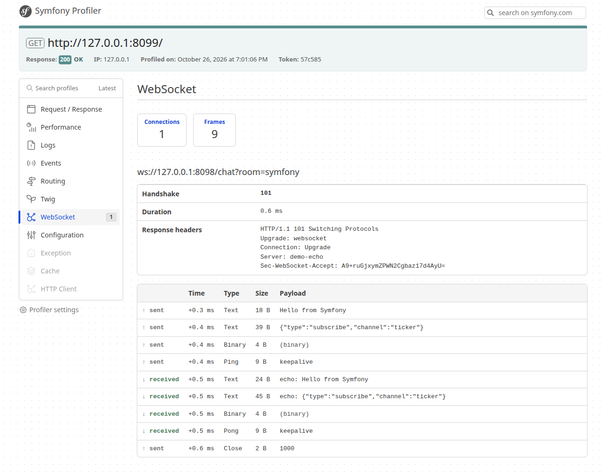

## WebSocket client for Symfony HttpClient contracts

A `Symfony\Contracts\HttpClient\HttpClientInterface` implementation that speaks WebSocket (RFC 6455).

### Installation

```
composer require valtzu/symfony-websocket-client
```

### Usage

```php
$client = new WebSocketClient(['timeout' => 10]);

$ws = $client->request('GET', 'wss://ws.postman-echo.com/raw');
$ws->getStatusCode(); // connects and performs the handshake; 101 on success

$ws->send('Hello world');

foreach ($client->stream($ws, 5) as $chunk) {
    if ($chunk->isTimeout()) {
        break;
    }
    if ($chunk->isFirst()) {
        continue;
    }
    echo $chunk->getContent(); // one complete message per chunk
}

$ws->close();
```

* Requests are lazy: connection and handshake happen on first use (`getStatusCode()`, `send()`, `stream()` ...). Failures throw `TransportException`.
* Only `GET` is allowed. Headers, `query`, `auth_*`, `base_uri`, `timeout` and the TLS options (`verify_peer`, `cafile`, ...) work as usual.
* `stream()` yields `FirstChunk`, one `DataChunk` per message (fragments are reassembled), then `LastChunk` once the connection is closed. Ping frames are answered automatically while streaming; an idle timeout yields a timeout chunk.
* `getContent()` blocks until the server closes the connection and returns all messages concatenated.
* A non-101 handshake reply (e.g. 403) is exposed as a normal response and `getContent()` throws the usual `HttpExceptionInterface`.
* `WebSocketResponse` adds `send(string $payload, bool $binary = false)`, `ping()` and `close()`.

### Symfony bundle

Register the bundle:

```php
// config/bundles.php
return [
    // ...
    Valtzu\WebSocketClient\ValtzuWebSocketClientBundle::class => ['all' => true],
];
```

The bundle

* decorates `http_client`, so `ws://` and `wss://` requests are handled by the WebSocket client while everything else goes to the regular HTTP client,
* registers an autowirable `Valtzu\WebSocketClient\WebSocketClient` service,
* adds a WebSocket panel to the Symfony profiler in debug mode.

```php
public function __construct(private HttpClientInterface $httpClient) {}

public function __invoke(): Response
{
    $ws = $this->httpClient->request('GET', 'wss://ws.postman-echo.com/raw');
    $ws->send('Hello world'); // $ws is a WebSocketResponse
    // ...
}
```

Optional configuration:

```yaml
# config/packages/valtzu_websocket_client.yaml
valtzu_websocket_client:
    default_options:
        timeout: 10
        headers:
            Authorization: 'Bearer ...'
```

Notes:

* `HttpClientInterface::stream()` accepts either only WebSocket responses or only HTTP responses, not a mix of both.
* Scoped clients (`framework.http_client.scoped_clients`) are not WebSocket-aware; inject `WebSocketClient` for those cases.
* `WebSocketClient` is the more explicit option when you do not want to rely on the `http_client` decoration.

### Profiler

In debug mode every connection is recorded with its handshake and each frame sent or received.



